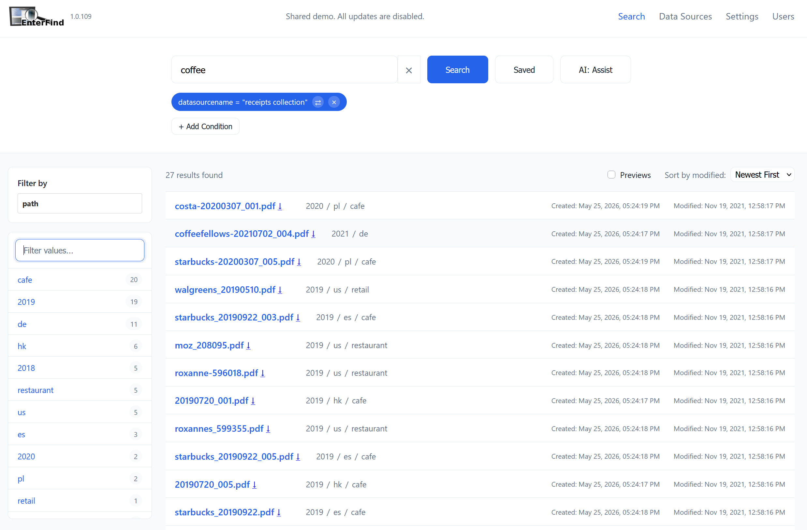

# Enterfind

Enterfind indexes the documents you already have — on local disks, network shares, and S3-compatible storage — and makes them searchable, both through its own web interface and through AI assistants like Claude and ChatGPT.

You point Enterfind at a **data source**, it **scans** the files, runs the **treatments** you choose (text extraction, OCR, object and face detection), and everything becomes searchable. Nothing is uploaded to a third party in the process: Enterfind runs on your own hardware, and your files stay where they are.

Everything Enterfind can do is reachable through a single GraphQL API. The web UI is a client of that API; so are the MCP and OpenAPI layers that let AI assistants search your documents. That means an AI assistant isn't bolted on — it reaches your corpus through the same interface you do.



## Try it first

A read-only demo instance indexes a small public corpus — a sample of Project Gutenberg books, Library of Congress PDFs, photos, and receipts. Browse it at [`https://b6b5b23e3ac8.remote-beta.enterfind.com/`](https://b6b5b23e3ac8.remote-beta.enterfind.com/), or add `https://b6b5b23e3ac8.remote-beta.enterfind.com/mcp` as a custom connector in claude.ai (or as an MCP server in the Gemini CLI) and ask it about those documents. No account or API key is needed. Searching and retrieving work; anything that would change the instance's configuration is blocked.

## Quickstart

Enterfind ships as a multi-architecture Docker image (linux/amd64 and linux/arm64): `ghcr.io/enterfind-base/enterfind-server-beta`.

It needs a PostgreSQL database alongside it. The quickest complete setup is the minimal Compose stack — the app plus Postgres, no proxy, no domain:

```bash
mkdir enterfind && cd enterfind
curl -fsSLO https://raw.githubusercontent.com/enterfind-base/enterfind-server/master/docker-compose.minimal.yml
curl -fsSL https://raw.githubusercontent.com/enterfind-base/enterfind-server/master/.env.minimal.template -o .env
# Edit .env: set DB_PASSWORD, and set ENTERFIND_ENCRYPTION_KEY to the output of `openssl rand -base64 32`
docker compose -f docker-compose.minimal.yml up -d
```

Then open `http://localhost:8080`. To index a folder on the host, uncomment the documents mount in `docker-compose.minimal.yml` and point a Local Filesystem data source at `/data/documents`.

**No Docker?** On a Windows, macOS or Linux computer, the [Enterfind installer](https://github.com/enterfind-base/enterfind-installer) sets up the server with its own Java, PostgreSQL and Tesseract in your home folder, with no admin rights — see [Installer](docs/installation.md#installer-no-docker).

[Installation](docs/installation.md) covers the other setups (existing Postgres, your own reverse proxy, building from source), and [Getting Started](docs/getting-started.md) walks from here to your first search.

## Documentation

**Start here**

- [Getting Started](docs/getting-started.md) — what Enterfind is and the path from zero to your first search.
- [Installation](docs/installation.md) — running Enterfind with the installer, via Docker or Docker Compose, or from source.
- [Concepts](docs/concepts.md) — the core vocabulary: data sources, items, treatments, scanning, search.

**Indexing your documents**

- [Data Sources](docs/datasources.md) — local filesystem, network shares (SMB/CIFS), and S3-compatible storage; scan scheduling and the scan lifecycle.
- [Treatments](docs/treatments.md) — overview and the per-item treatment status model.
  - [Name and Path](docs/treatment-name-and-path.md)
  - [Content](docs/treatment-content.md)
  - [OCR](docs/treatment-ocr.md)
  - [Object Detection](docs/treatment-object-detection.md)
  - [Face Detection](docs/treatment-face-detection.md)
  - [Face Recognition](docs/treatment-face-recognition.md)

**Finding things**

- [Search](docs/search.md) — search strings, conditions, folders, facets, and saved queries.
- [Item Attributes](docs/item-attributes.md) — the key/value facts that treatments produce and search filters on.
- [Saved Queries](docs/saved-queries.md) — naming and recalling searches you run often.

**Access and integration**

- [Users and Access Control](docs/users-and-access.md) — optional authentication, the READER and ADMIN levels, human users, and API keys.
- [Connecting AI Assistants](docs/ai-access.md) — the two MCP paths (remote proxy URL and local MCP server) plus OpenAPI for ChatGPT.
- [AI Helper](docs/ai-helper.md) — the assistant built into Enterfind for scheduling, skip patterns, and natural-language search, and how to configure its provider.
- [Remote Access](docs/remote-access.md) — reaching your instance from outside your network through the Enterfind tunnel.
- [The API](docs/api.md) — the GraphQL surface, authenticating with an API key, and common operations.
- [Testing MCP Search Locally](docs/testing-mcp-locally.md) — standing up a local build and driving it with a fresh assistant to check that MCP search behaves.

**Operating your instance**

- [Operations](docs/operations.md) — where the logs are, checking on scans, backups, disk growth, and what an upgrade does to the schema.
- [ARM Hardware Compatibility](docs/arm-hardware.md) — which ARM boards and NAS devices the image runs on, and which it doesn't.

## About

Enterfind is in public beta. Anyone can run the server; remote access through the hosted tunnel is by invite for now (see [Remote Access](docs/remote-access.md)).

Maintained by [mikhailgarber](https://github.com/mikhailgarber). For questions, invite codes, and commercial licensing, write to [info@enterfind.com](mailto:info@enterfind.com). Website: [enterfind.com](https://enterfind.com).

Enterfind is licensed under the AGPLv3 (see [LICENSE](LICENSE)). A commercial license is available separately for embedding Enterfind in a proprietary product.

All code and documentation is Copyright (c) 2026 Mikhail Garber
